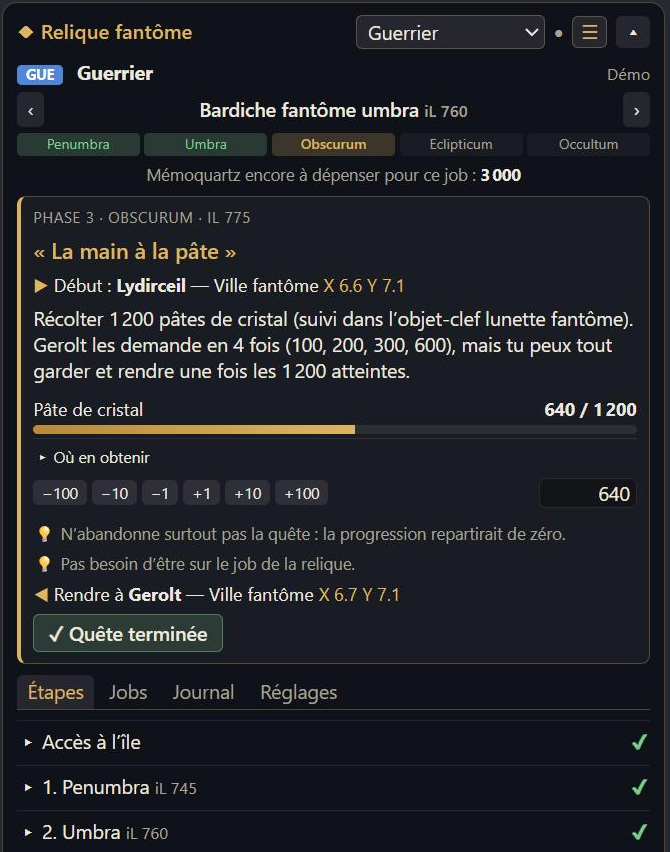

# Suivi des reliques — overlay ACT pour les armes reliques de FFXIV

**Français** · [English](README.md)

Overlay pour **ACT + OverlayPlugin** qui suit tes armes reliques, job par job :

| Extension | Relique | Stades | Jobs |
|---|---|---|---|
| Dawntrail (niv. 100) | Armes fantômes | Penumbra iL 745 → Occultum iL 795 | 21 |
| Endwalker (niv. 90) | Armes Manderville | Manderville iL 615 → Manderveilleuse iL 665 | 19 |
| Shadowbringers (niv. 80) | Armes de la Résistance | Résistance iL 485 → Gunnhildr iL 535 | 17 |
| Stormblood (niv. 70) | Armes d'Eurêka | Vieillie iL 290 → Personnalisée iL 405 | 15 |
| Heavensward (niv. 60) | Armes Anima | Animée iL 170 → Lux iL 275 | 13 |
| A Realm Reborn (niv. 50) | Armes du Zodiaque | Zodiaque iL 80 → Zêta iL 135 | 10 |

Choisis la relique en haut de l'overlay. Il te montre où tu en es et **ce qu'il faut faire ensuite** : quête, PNJ et coordonnées, objets à réunir et où les obtenir.
Pour les anciennes reliques, les étapes sont **celles d'aujourd'hui** : les objets qui venaient d'un contenu retiré ou d'une autre monnaie sont indiqués avec leurs sources actuelles, **le farm d'abord, l'achat ensuite** (mémoquartz poétiques, sceaux de compagnie).



**Fonctionne avec le jeu en français, en anglais ou en allemand.** L'overlay reprend tout seul la langue de ton jeu, et tous les noms du jeu (objets, quêtes, PNJ, lieux, missions) sont les noms officiels de cette langue, tirés des données du jeu.

**[Essayer la démo dans le navigateur](https://DarknessKxiv.github.io/ffxiv-relique/?demo&lang=fr)** (progression d'exemple, rien n'est enregistré).

## Fonctionnalités

- **Prochaine étape** du job suivi : la quête, le PNJ avec ses coordonnées, les objets à réunir et leur source.
- **Toutes les phases** détaillées : pour Dawntrail, demi-âtma, Magi sphérier, pâtes de cristal, dissipateurs, cristal de savoir (65 objectifs) ; pour Endwalker, les quêtes d'Hildibrand et les échanges de mémoquartz ; pour les anciennes reliques, chaque objet à réunir par arme, les quêtes uniques et les missions à réussir avec chaque job.
- **Où farmer** : les ALÉA et affrontements cruciaux de Lunule qui donnent chaque demi-âtma ou dissipateur.
- **Suivi de chaque job**, avec les mémoquartz restant à dépenser pour chacun.
- **Détection automatique** pendant que tu joues (voir plus bas), avec le job suivi qui s'adapte au job joué.
- **Trois affichages** : complet, compact (bouton ☰, sans les onglets) ou **réduit à une seule barre** (bouton ▴) qui montre juste la prochaine étape.
- **Masquage automatique pendant les donjons, défis et raids** (activé par défaut, désactivable dans les Réglages). L'overlay reste affiché sur l'Île de Lunule, à Bozja, Zadnor et Eurêka.
- Progression enregistrée **séparément pour chaque personnage**.

## Installation

Il faut [ACT](https://advancedcombattracker.com/) avec le plugin FFXIV et [OverlayPlugin](https://github.com/OverlayPlugin/OverlayPlugin). Le jeu doit être en mode **fenêtré sans bordure**.

1. Dans ACT : onglet **Plugins** → sous-onglet **OverlayPlugin.dll** → bouton **Nouveau**.
2. **Nom** : `Relique` ; **Preset** : **Personnalisé** ; **Type** : **MiniParse** → valider.
3. Dans l'onglet **Général** du nouvel overlay, remplis le champ **URL** avec :
   ```
   https://DarknessKxiv.github.io/ffxiv-relique/
   ```
   puis clique sur **Recharger l'overlay**.
4. Laisse **Clic à travers** décoché, sinon tu ne pourras pas cliquer dans l'overlay.
5. Décoche **Bloquer l'overlay**, place et redimensionne la fenêtre en jeu (environ 500 px de large), puis recoche-la.
6. Facultatif : onglet **Raccourcis** → **Nouveau raccourci**, type **Visible/Caché**, pour l'afficher ou le cacher d'une touche.

**Texte trop petit (écran 4K) ?** Utilise le curseur **Zoom** de l'onglet **Général**, ou les boutons **A− / A+** dans les **Réglages** de l'overlay.

Les mises à jour arrivent toutes seules : l'overlay est chargé depuis GitHub Pages.
Pour une version 100 % locale, télécharge le dépôt (**Code → Download ZIP**) et mets `file:///C:/chemin/vers/ffxiv-relique/index.html` dans le champ URL.

**Sous Linux ou macOS** (ou pour l'afficher dans un navigateur ou OBS) : démarre le serveur WebSocket d'OverlayPlugin (onglet **WSServer** → **Start**), puis utilise cette URL :
```
https://DarknessKxiv.github.io/ffxiv-relique/?OVERLAY_WS=ws://127.0.0.1:10501/ws
```

## Première utilisation

1. Onglet **Jobs** : règle avec ‹ › l'arme fantôme que possède chaque job. Tout ce qui précède est coché automatiquement.
2. Onglet **Étapes** : coche les quêtes déjà faites de la phase en cours.
3. Entre tes compteurs actuels (demi-âtma, pâtes de cristal, jauges du Magi sphérier…) avec les boutons + / −.

Dans ACT, l'overlay ne reçoit pas le clavier : utilise les boutons + / − plutôt que les cases de saisie.

## Détection automatique

Quand ACT tourne, l'overlay lit le journal du jeu transmis par OverlayPlugin.

| Détecté automatiquement | À mettre à jour soi-même |
|---|---|
| Personnage et job joué | Quêtes terminées (bouton « ✓ Quête terminée ») si aucun message n'a été vu |
| Langue du jeu | Jauges du Magi sphérier |
| Demi-âtma, pâtes de cristal, dissipateurs obtenus | ALÉA au rang or et monstres du cristal de savoir |
| Objets d'amélioration achetés (lunulite, météorite rarissime…) | |
| Objets de quête (colle, matières sombres, etc.) | |
| Armes reliques reçues | |
| Quêtes acceptées et terminées | |
| Missions réussies du cristal de savoir | |
| Missions à réussir avec le job d'une arme (étapes Anima…) | Livres d'épreuves, matérias, lumière, mahatma, densité |

Seuls les **messages système** sont pris en compte : ce que les joueurs écrivent dans le chat est ignoré.
Tout ce qui est détecté apparaît dans l'onglet **Journal**.

## Confidentialité

L'overlay n'envoie **aucune donnée** nulle part. Il lit seulement les évènements qu'ACT lui transmet sur ton PC.
Ta progression est stockée dans la configuration d'OverlayPlugin, sur ton PC.
**Réglages → Exporter** donne un texte de sauvegarde à garder ailleurs.

## Bon à savoir

- Les grosses étapes (demi-âtma, Magi sphérier, pâtes de cristal, dissipateurs, cristal de savoir) ne se font **qu'une fois par personnage**.
  Pour chaque autre job, il suffit ensuite de 1 500 mémoquartz par phase, et la phase Occultum est gratuite.
- N'abandonne jamais « Quatre orbes et une roulette » ni « La main à la pâte » : la progression repartirait de zéro.

## Pour les développeurs

Aucune compilation : du HTML, CSS et JavaScript simples.

| Fichier | Rôle |
|---|---|
| `index.html`, `style.css` | Page de l'overlay |
| `js/etapes.js` | Structure commune : jobs et coordonnées des PNJ (sans texte) |
| `js/reliques/*.js` | Un fichier par relique : phases, quêtes et tâches (sans texte) |
| `js/textes.js` | Textes de l'interface en français, anglais et allemand |
| `js/noms-jeu.js` | Noms officiels du jeu dans chaque langue (généré) |
| `js/detection.js` | Lecture des lignes du journal ACT (formats officiels des messages de chaque langue) |
| `js/app.js` | État, affichage, sauvegarde |
| `js/overlay-api.js` | Liaison avec OverlayPlugin, par sa bibliothèque officielle |
| `js/vendor/overlayplugin-common.js` | `common.js` d'OverlayPlugin (non modifié, MIT) : connexion à ACT et par WebSocket |
| `outils/generer-noms.mjs` | Régénère `noms-jeu.js` depuis XIVAPI : `node outils/generer-noms.mjs` |

Ajoute `?test` à l'URL pour des boutons qui simulent des lignes de journal (onglet Réglages), `?demo` pour une progression d'exemple, et `?lang=fr|en|de` pour présélectionner une langue. La fenêtre d'aperçu d'OverlayPlugin (ajout de l'overlay depuis un preset) montre la même progression d'exemple.

## Sources et mentions

- Étapes : ffxiv.consolegameswiki.com ([Zodiac](https://ffxiv.consolegameswiki.com/wiki/Zodiac_Weapons), [Anima](https://ffxiv.consolegameswiki.com/wiki/Anima_Weapons), [Eurekan](https://ffxiv.consolegameswiki.com/wiki/Eurekan_Weapons), [Resistance](https://ffxiv.consolegameswiki.com/wiki/Resistance_Weapons), [Manderville](https://ffxiv.consolegameswiki.com/wiki/Manderville_Weapons), [Phantom Weapons](https://ffxiv.consolegameswiki.com/wiki/Phantom_Weapons)) et [tutostation.fr — guide relique Dawntrail](https://www.tutostation.fr/archive/2024/12/13/final-fantasy-xiv-guide-relique-dawntrail.html).
- Liaison avec ACT : `common.js` d'[OverlayPlugin](https://github.com/OverlayPlugin/OverlayPlugin) (MIT).
- Noms officiels du jeu et formats des messages : [XIVAPI](https://v2.xivapi.com).
- Projet non officiel, sans lien avec Square Enix. FINAL FANTASY XIV © SQUARE ENIX CO., LTD. Tous droits réservés.

## Licence

[MIT](LICENSE)
