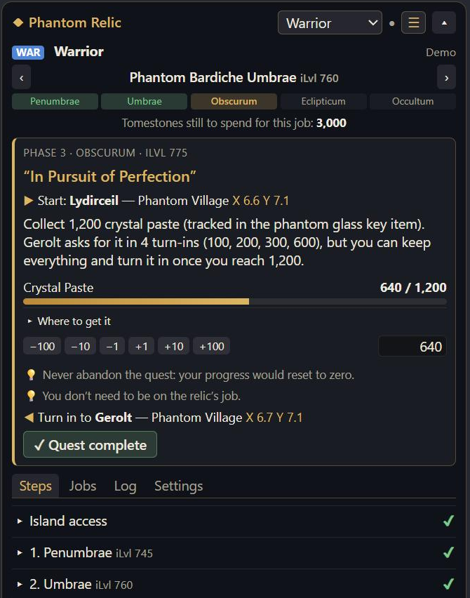

# Phantom Relic — ACT overlay for FFXIV Dawntrail

[Français](README.fr.md) · **English**

An overlay for **ACT + OverlayPlugin** that tracks the Dawntrail relic weapons (Phantom Weapons, from **Penumbrae iLvl 745** to **Occultum iLvl 795**) for all **21 combat jobs**.
It shows where you are and **what to do next**: the quest, the NPC and its coordinates, the items to gather and where to get them.



**Works with the English, French and German game clients.** The overlay picks the language of your game automatically, and every game name (items, quests, NPCs, places, duties) is the official one for that language, taken from the game data.

**[Try the demo in your browser](https://DarknessKxiv.github.io/ffxiv-relique/?demo&lang=en)** (sample progress, nothing is saved).

## Features

- **Next step** for the tracked job: quest, NPC with coordinates, items to gather and where to get them.
- **Every phase in detail**: demiatma, Aetherwell Array, crystal paste, phantom dispellers, knowledge crystal (65 objectives).
- **Where to farm**: which Occult Crescent FATEs and critical engagements give each demiatma or dispeller.
- **All 21 jobs** tracked, with the tomestones left to spend for each.
- **Automatic tracking** while you play (see below); the tracked job follows the job you are playing.
- **Three display sizes**: full, compact (☰, no tabs) or **collapsed to a single bar** (▴) showing just the next step.
- **Hidden automatically during dungeons, trials and raids** (on by default, can be turned off in Settings). It stays visible in the Occult Crescent.
- Progress saved **separately for each character**.

## Installation

You need [ACT](https://advancedcombattracker.com/) with the FFXIV plugin and [OverlayPlugin](https://github.com/OverlayPlugin/OverlayPlugin). Play the game in **borderless windowed** mode.

1. In ACT: **Plugins** tab → **OverlayPlugin.dll** → **New**.
2. **Name**: `Phantom Relic`; **Preset**: **Custom**; **Type**: **MiniParse** → OK.
3. In the **General** tab of the new overlay, set the **URL** to:
   ```
   https://DarknessKxiv.github.io/ffxiv-relique/
   ```
   then click **Reload overlay**.
4. Leave **Enable clickthrough** unchecked, otherwise you cannot click in the overlay.
5. Uncheck **Lock overlay**, move and resize the window in game, then lock it again.
6. Optional: **Hotkeys** tab → new hotkey of type **Toggle visibility** to show or hide it with a key.

**Text too small (4K screen)?** Use the **Zoom** slider in the **General** tab, or the **A− / A+** buttons in the overlay **Settings**.

Updates arrive on their own, because the overlay is loaded from GitHub Pages.
For a fully local copy, download the repository (**Code → Download ZIP**) and use `file:///C:/path/to/ffxiv-relique/index.html` as the URL.

## First use

1. **Jobs** tab: set each job's phantom weapon with ‹ ›. Everything before it is checked automatically.
2. **Steps** tab: tick the quests you have already done in your current phase.
3. Enter your current counters (demiatma, crystal paste, Aetherwell Array gauges…) with the + / − buttons.

Inside ACT the overlay does not receive keyboard input: use the + / − buttons rather than the input boxes.

## Automatic tracking

While ACT is running, the overlay reads the game log that OverlayPlugin passes to it.

| Tracked automatically | Updated by hand |
|---|---|
| Character and job being played | Completed quests (“✓ Quest complete” button) when no message was seen |
| Game language | Aetherwell Array gauges |
| Demiatma, crystal paste, phantom dispellers obtained | Gold-rated FATEs and monsters of the knowledge crystal |
| Arcanite bought (all four kinds) | |
| Quest items (glue, synthetic dark matter, etc.) | |
| Phantom weapons received | |
| Quests accepted and completed | |
| Knowledge crystal duties completed | |

Only **system messages** are used: what players type in chat is ignored.
Everything detected shows up in the **Log** tab.

## Privacy

The overlay sends **no data** anywhere. It only reads the events ACT gives it on your PC.
Your progress is stored in OverlayPlugin's settings on your PC.
**Settings → Export** gives you a save text to keep somewhere else.

## Good to know

- The big steps (demiatma, Aetherwell Array, crystal paste, dispellers, knowledge crystal) are done **only once per character**.
  Every other job then only needs 1,500 tomestones per phase, and the Occultum phase is free.
- Never abandon “Aether, Aether, Everywhere” or “In Pursuit of Perfection”: the progress would reset to zero.

## For developers

No build step: plain HTML, CSS and JavaScript.

| File | Purpose |
|---|---|
| `index.html`, `style.css` | Overlay page |
| `js/etapes.js` | Structure: jobs, NPCs, phases, quests and tasks (no text) |
| `js/textes.js` | Interface text in French, English and German |
| `js/noms-jeu.js` | Official game names in each language (generated) |
| `js/detection.js` | Reads the ACT log lines (official message formats of each language) |
| `js/app.js` | State, display, saving |
| `js/overlay-api.js` | Link with OverlayPlugin |
| `outils/generer-noms.mjs` | Regenerates `noms-jeu.js` from XIVAPI: `node outils/generer-noms.mjs` |

Add `?test` to the URL for buttons that simulate log lines (Settings tab), `?demo` for sample progress, and `?lang=fr|en|de` to preselect a language.

## Sources and credits

- Steps: [ffxiv.consolegameswiki.com — Phantom Weapons](https://ffxiv.consolegameswiki.com/wiki/Phantom_Weapons) and [tutostation.fr — Dawntrail relic guide](https://www.tutostation.fr/archive/2024/12/13/final-fantasy-xiv-guide-relique-dawntrail.html).
- Official game names and log message formats: [XIVAPI](https://v2.xivapi.com).
- Unofficial project, not affiliated with Square Enix. FINAL FANTASY XIV © SQUARE ENIX CO., LTD. All rights reserved.

## License

[MIT](LICENSE)
